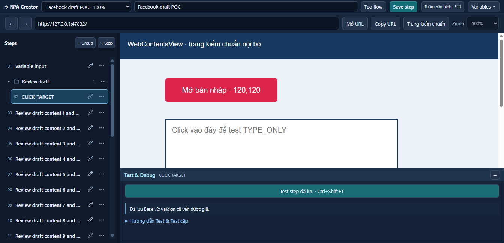
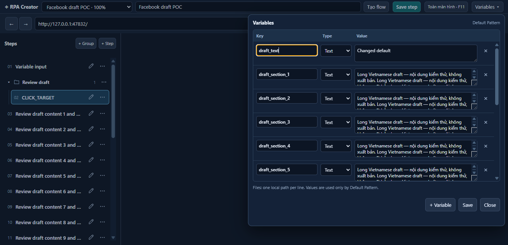
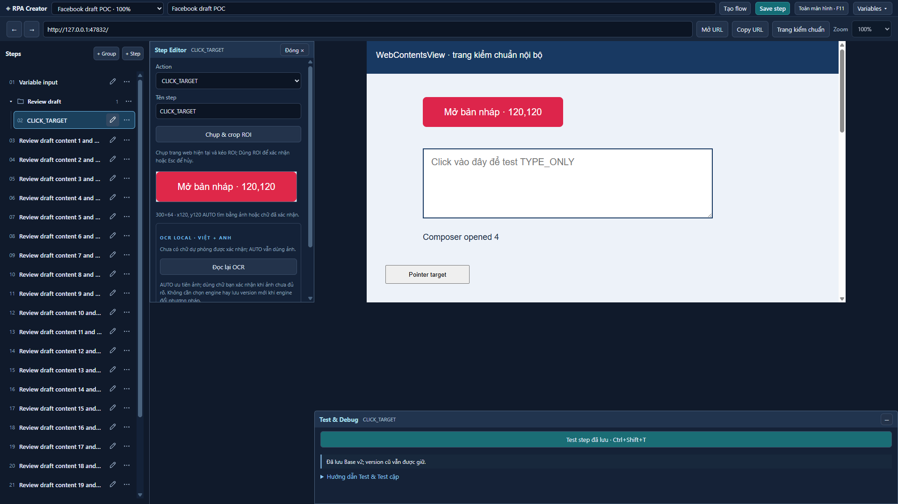

# Creator UI cleanup

## Scope

UI-only continuation on `feature/creator-ui-refactor`. The initial working tree contained only the existing untracked `rpa-social-automation-v2/` directory; it is excluded. No changes to database/storage, contracts/schema, Variables/Pattern model, Group model/validation, OCR, BrowserCore, Action Executor or Runtime. No production database/session files or Facebook content were changed.

## Changed files

Production presentation files:

- `src/renderer/step-list.tsx`: one 38-DIP row per Step; number/name plus SVG Edit/menu icons, selected state, collapsible folder groups and small indentation. Existing move/edit/reorder operations are exposed on demand through menus using the same commands/data structure.
- `src/renderer/flow-controls.tsx`: only + Group / + Step at the list header; Name/Slug creation form on demand; compact Key/Type/Value table with internal scrolling and persistent Save controls. Existing Variables/default-value handlers are retained.
- `src/renderer/ui-popover.tsx` (new): shared portal presentation, viewport clamping, Escape/focus containment, outside dismissal and a background pointer blocker. Uses the existing browserVisible command to hide native surfaces while a floating control is open, then restore them; no page reload or native view replacement. This avoids native WebContentsView painting above or receiving clicks through a DOM popover.
- `src/renderer/main.tsx`: wires the compact toolbar and determines Editor placement from window width, independently of the centered browser origin.
- `src/renderer/style.css`: compact rows, independent list scrolling, consistent SVG/button sizing, folder indentation, bounded popover table, and a single-line Editor close control. Debug styles are unchanged.
- `src/shared/geometry.ts`: centers only the fixed browser horizontally in its available region. The Debug geometry calculation remains unchanged; browser width/height/Flow zoom remain 1024 × 560 DIP / the saved zoom.

Validation files:

- `src/main/creator-ui-self-test.ts`: physical-input UI regressions and screenshots for group creation/menu moves, selecting/editing without execution, row height, independent scrolling, Variables edit/delete/save, native stacking, live modal preservation and centered fullscreen/Editor placement.
- `src/main/self-test.ts`, `src/main/typing-self-test.ts`, `src/main/upload-self-test.ts`: update the Step toolbar label expected by existing fixtures.
- `src/main/ux-self-test.ts`: expect the centered browser position while keeping the same viewport and target ROI checks.
- `tests/workspace.test.ts`: checks browser centering separately from unchanged Debug position, width, bottom anchor and expanded/collapsed height.
- `UI_CLEANUP.md`: this report.

## UI evidence

The images are generated by the real Electron Creator UI, driven by automated Windows mouse input. The embedded web page is the local calibration fixture, not Facebook. Live browser/modal retention and native stacking are exercised against that local page. They do not establish that Facebook itself passed.

Screenshots in `artifacts/`:

- `ui-cleanup-compact.png`: compact Steps and folder group with independent list scrollbar.
- `ui-cleanup-group-form.png`: on-demand Name/Slug form.
- `ui-cleanup-step-menu.png`: group move menu, rendered outside sidebar overflow.
- `ui-cleanup-variables.png`: bounded Key / Type / Value table with long values and internal scrolling.
- `ui-cleanup-wide.png`: browser centered in fullscreen with fixed viewport.
- `ui-cleanup-wide-editor.png`: Editor in the available column, centered browser and original Debug anchor/size.

The six reviewed screenshots are also committed under `docs/ui-cleanup/` for review after checkout. Raw `artifacts/browser-*.json` reports and generated artifacts remain local/ignored.

## Recorded validation

- `npm run typecheck`: passed.
- `npm test`: 32 passed.
- `npm run build`: passed.
- `npm run test:browser`: exit 0; 103 passing checks across eight phases.
- `node scripts/browser-test.mjs creator-native`: 15 passing checks, including physical outside-menu dismissal over the underlying browser target without a click leaking through.
- The existing first-phase report remains partial with three explicit limitations/manual checks: capture focus preservation, hidden-window capture and physical Ctrl+Shift+T acceptance. They are not counted as passes.
- All browser fixtures used isolated test profiles and the local fixture page. Facebook itself was not tested and no post was published.

## Manual Facebook follow-up

Open an existing Facebook composer/modal, select a Step, edit/close it and open/close Variables and Step menus. Confirm that no action runs on selection or menu dismissal, the same modal/draft remains, and Group moves persist after reopening the Flow. Test normal/fullscreen layout at the saved Flow zoom. Review any Click/Type/Upload only as a draft; do not publish. Automated local fixtures are not a substitute for this check.
