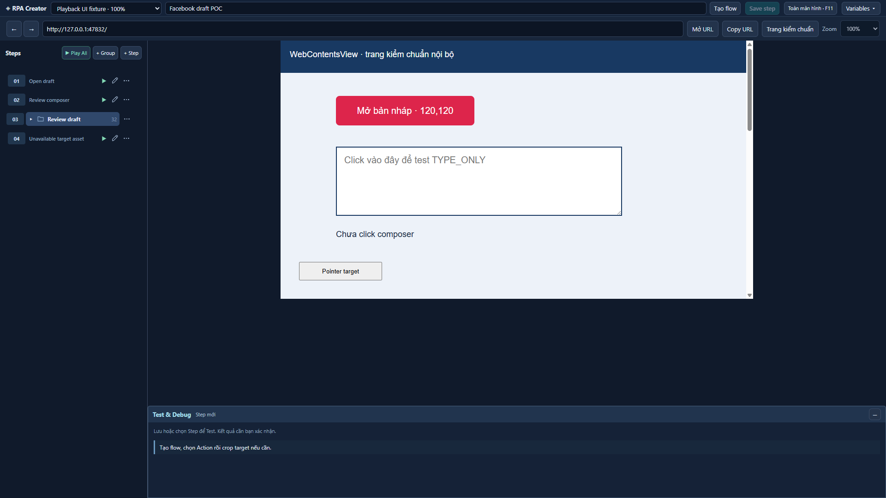
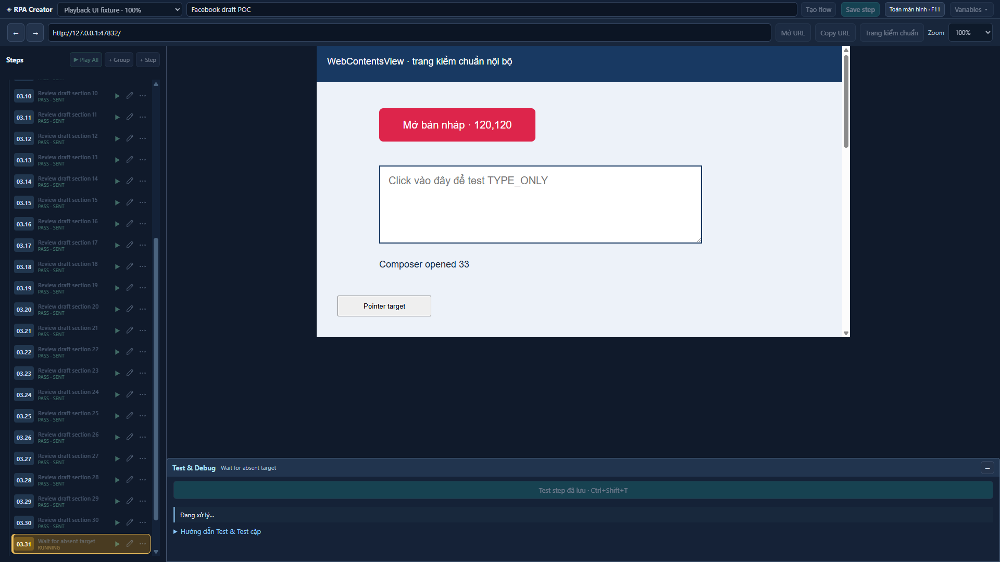
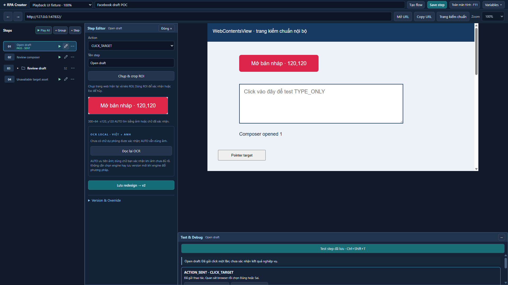
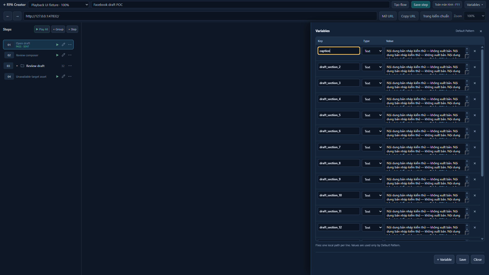
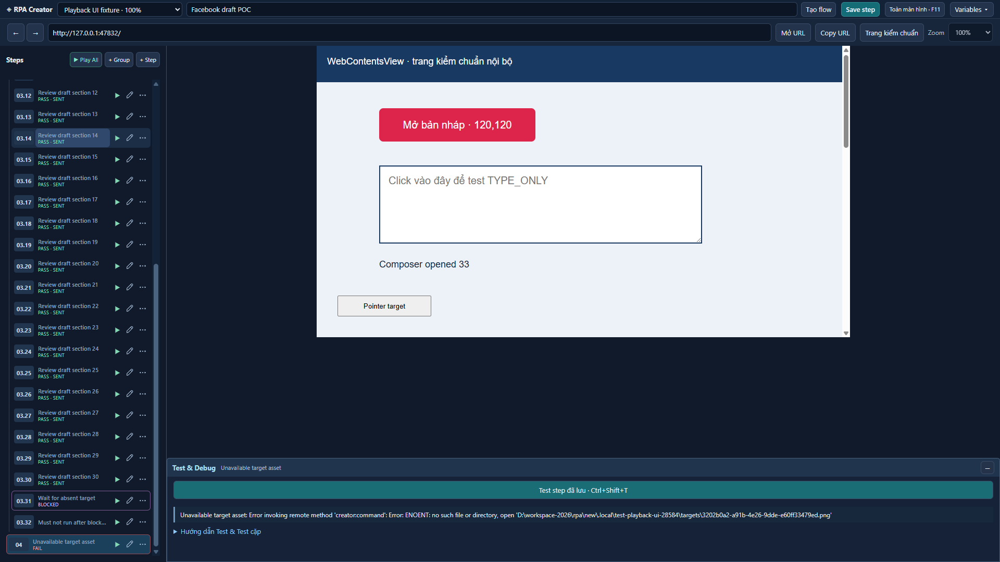

# Creator UI controls: playback and full-height drawers

Branch: `feature/creator-ui-refactor`. UI-only follow-up; no database, Visual Engine, OCR, action executor or runtime implementation changes.

## Behavior

- Editor fills the app below the 88 DIP topbar. Browser remains 1024 x 560 DIP at the saved Flow zoom. Test & Debug layout rules are unchanged.
- Each Step has Play; the Steps header has Play All. Both use the existing Test API and pinned Flow step versions. Play All runs in canonical Flow order and stops on fail/blocked. Selection alone never executes.
- Separate ordinal column: 01, 02, group folder 03 and children 03.1, 03.2. Running steps are highlighted, their groups revealed locally, and only the Step List scrolls to follow them. Group collapse persistence is unchanged.
- Running/pass/fail/blocked indicators are transient UI state. ACTION_SENT is labeled `pass · sent`; it is not upgraded to verified business success.
- Variables uses a full-height right drawer with a scrolling Key/Type/Value table and visible Save/Close controls. Existing Default Pattern and variable save handlers remain.
- The existing native-view visibility guard temporarily hides browser/Debug native surfaces while the drawer is open, avoiding WebContentsView stacking/click-through. It restores the same views on close without reload, recreation or bounds changes. The session and open HTML modal survive.

## Changed files

| Files | Purpose |
| --- | --- |
| `src/renderer/main.tsx`, `playback.ts` | UI playback coordinator through existing Test IPC; transient progress |
| `src/renderer/step-list.tsx`, `flow-controls.tsx` | Play controls, ordinals, statuses, drawer contents |
| `src/renderer/ui-popover.tsx`, `style.css` | Drawer variant, full-height panels and UI styling |
| `tests/playback.test.ts` | Serialization/order, stop conditions, errors and ACTION_SENT preservation |
| `src/main/playback-ui-self-test.ts` | Dedicated isolated native Electron UI fixture |
| `src/main/creator-ui-self-test.ts` | Existing Variables selectors updated to drawer |
| `src/main/main.ts`, `scripts/browser-test.mjs` | Test-phase registration only |
| `docs/ui-controls/*`, this report | Reviewed screenshots and evidence |

## Validation

- Typecheck: passed.
- Unit tests: 36 passed.
- Production build: passed.
- Dedicated native playback fixture: 5 checks passed. It checks physical per-step Play, non-executing selection, ordering, active auto-scroll, stop on blocked, failure without click, full-height Editor/drawer, long variable table, save/close, modal retention, unchanged browser/Debug bounds and Flow zoom.
- Existing Creator UI fixture: 15 checks passed. Completed regression phases: first 26, second 3, UX 16, OCR 9, typing 13. First retains 3 existing limitations/manual checks (capture focus, hidden-window capture, physical Ctrl+Shift+T).
- Initial full-suite attempt stopped at a native browser-focus assertion in first; that phase passed on retry. The follow-up run was stopped during upload at the user's request to avoid further mouse/focus interference. Upload and address were not completed in this run; no further GUI fixtures were launched.

All screenshots below come from the real Electron Creator UI using a local calibration page and isolated test profiles. They are not Facebook screenshots. Facebook itself has not been tested. No post was published.

## Screenshots

