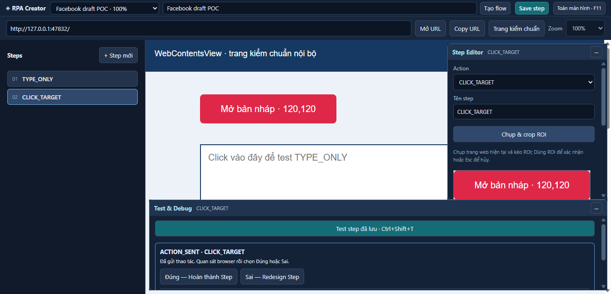

> Match To cập nhật 2026-10-20 (chưa test):
> - Top = 1/3 đầu, Middle = 2/3 đầu, Bottom = toàn vùng cuộn. Cả ba về đầu container,
>   đợi render, chụp mới rồi mới OCR; tiếp tục xuống từng đoạn 200 DIP. Không OCR vị trí cũ trước reset.
> - Chỉ xét bbox OCR nằm trong container/phần phạm vi đang quét; Current không cuộn.
> - Giữ giới hạn 40 lượt xuống / 120 giây / 8000 DIP; tính lại phạm vi theo chiều cao lazy-load.
> - OCR đơn thuần không đủ: phải có dòng ngữ cảnh độc lập (≥10 ký tự, confidence ≥80%) trong ảnh target đã lưu,
>   và mọi dòng ngữ cảnh đủ điều kiện phải khớp (không nhận riêng một từ tên tác giả). Ví dụ tác giả/tiêu đề,
>   khớp vị trí tương đối và score ảnh ngoài bbox chữ ≥0.96. Crop chỉ chứa nhãn/nút chung bị BLOCKED.
> - Top/Middle/Bottom xét từng ứng viên chữ, chỉ nhận đúng một ứng viên có context được xác nhận.
>   Context không khớp thì tiếp tục quét; thiếu context trong ảnh lưu hoặc nhiều context trùng thì BLOCKED.
> - Current giữ AUTO trong viewport; nhánh OCR fallback cũng bắt buộc xác nhận context, không click theo chữ đơn lẻ.
> - Log mỗi lượt có OCR candidates, context/anchor/imageScore, vị trí, phạm vi; kết quả ghi
>   MATCHED_CONTEXT_CONFIRMED hoặc nguyên nhân BLOCKED, kèm trace của lượt cuối.
> - Không đổi browser.click, imageToInput, Click Marker, dữ liệu Step/Version/Override hay thuật toán visual.ts.
> - Không chạy test/build/typecheck hoặc Electron. Ghi chú bên dưới mô tả các phiên bản cũ.

> Audit Match To/OCR (chưa kiểm thử thực tế):
> - Nguyên nhân tĩnh: Top/Middle/Bottom OCR toàn viewport nhưng OCR cũ từ chối ảnh >1024×560;
>   Current dùng AUTO Image Matching + OCR quanh ROI, nên hai chế độ có thể cho kết quả khác nhau.
> - Ảnh cao nay được chia thành dải 560px, overlap 80px. Bbox cộng offset dải trong screenshot,
>   khử trùng bbox chồng lấn; không cộng scrollTop và không dùng ROI cũ làm tọa độ sau cuộn.
> - NOT_FOUND tiếp tục tìm; OCR_TECHNICAL báo FAILED riêng. Ambiguous/low-confidence giữ chặn an toàn.
> - Giới hạn tìm: 40 lượt / 120 giây / 8000 DIP. Sau lazy-load, tính lại đích từ chiều cao hiện tại;
>   không đánh dấu kết thúc sớm chỉ vì đã chạm chiều cao trang trước khi render.
> - OCR viewport chỉ kiểm tra width/zoom target; không phụ thuộc chiều cao ROI cũ. Current giữ guard cũ.
> - Runtime báo cấu hình version/Override/Match To thực tế. Editor báo thay đổi chưa lưu;
>   Play danh sách dùng Base đã ghim và không ghi đè bản nháp. BLOCKED không tự mở Redesign nữa.
> - Lượt bắt đầu xóa kết quả cũ, thay trạng thái Step bằng running rồi nhận kết quả mới.
>   Log `runs/creator-execution.jsonl`: runId, version, matchTo, pipeline, OCR passes, scrolls, stopReason.
>   Lỗi kỹ thuật/trace nằm trong `runs/creator-errors.jsonl`. Metadata bổ sung chỉ ghi vào lượt chạy mới.
> - Giữ nguyên Visual Engine, browser.click, imageToInput, Click Marker và dữ liệu/version cũ.
> - Chưa test theo yêu cầu: không chạy test/build/typecheck hoặc mở Electron. Các ghi chú dưới là lịch sử.

> Bổ sung: double-click chữ OCR đã xác nhận để sửa trong Editor; Enter nhận chữ,
> Esc/blur hủy, X bỏ OCR. Lưu Step/Redesign theo luồng sẵn có để ghi thay đổi.
> Giữ ảnh target, ROI và metadata OCR. Không tự tạo version khi Enter.
> DevTools mặc định tắt. Chạy Creator với `$env:CREATOR_DEVTOOLS="1"` để dùng F12
> mở/đóng DevTools Facebook bằng cửa sổ detached; không tự mở khi khởi động.
> Flag bị vô hiệu khi app.isPackaged hoặc NODE_ENV=production. F11 và Ctrl shortcut giữ nguyên.
> Lỗi OCR/Runtime Main Process ghi console và `runs/creator-errors.jsonl` dưới dataPath;
> DevTools Facebook chỉ xem log của renderer Facebook. BLOCKED hiển thị lý do lỗi cụ thể.
> Các thay đổi này chưa test theo yêu cầu; không chạy build/typecheck hay mở Electron.

> Cập nhật 2026-10-19: bỏ Bottom Test & Debug khỏi workspace; dùng Play cạnh Edit.
> Browser rộng 1024 DIP, cao theo workspace; Editor cuộn nội bộ. Variables ở cột trái,
> không ẩn/reload browser. Match To chỉ có với OCR xác nhận: Current giữ pipeline cũ;
> Top/Middle/Bottom OCR viewport hiện tại trước, rồi cuộn từng đoạn khoảng 200 DIP,
> đợi 250ms, chụp mới và OCR lại. Dừng ngay khi tìm thấy; tọa độ OCR giữ theo viewport.
> Giữ một scroll container trong isolated world; có modal thì không fallback trang nền.
> Chặn khi tới đích, đổi modal/container hoặc hết giới hạn 40 lượt / 20 giây / 8000 DIP.
> Đích cập nhật theo scrollHeight sau lazy-load nhưng hướng cuộn được giữ để tránh quay vòng.
> Marker Creator là cửa sổ trong suốt 12px, bỏ qua chuột/focus, tự ẩn sau 3 giây.
> Giữ kiểm tra môi trường target: target cũ khác chiều cao viewport vẫn bị chặn an toàn;
> cần crop lại ở viewport hiện tại nếu gặp thông báo không khớp. Không tự sửa version/override.
> Chưa test theo yêu cầu: không chạy unit test, fixture, GUI test, build hoặc typecheck.
> Nội dung bên dưới là lịch sử của phiên bản trước, không phải kết quả kiểm thử thay đổi này.

# Creator: Editor dạng cột và chẩn đoán pointer

Branch `feature/creator-ui-refactor`; không merge main. Giữ nguyên thư mục untracked `rpa-social-automation-v2/`.

## Trạng thái xác nhận

**Lỗi click trên Facebook chưa được xác nhận đã sửa.** Chưa đủ bằng chứng để kết luận click mất ở Step List, Editor, Debug hay browser trên desktop người dùng. Không dùng kết quả synthetic `sendInputEvent` để tuyên bố native hit-testing đã đạt.

Phát hiện trong bài test cũ: `self-test.ts` gọi lại `addChildView(browser.view)`, đưa browser lên đầu stack, làm khác z-order production. Đã bỏ thao tác đó. Đây là lỗi trong kiểm thử, chưa phải bằng chứng về nguyên nhân click mất trên Facebook.

Kiểm tra tĩnh/bố cục cũ cho thấy Editor và Debug có bounds riêng trên browser; không che Step List theo bounds đã khai báo. Bản mới bỏ native Editor hoàn toàn: Editor nằm trong DOM shell, không có native surface vô hình của Editor phía trên Facebook. Chỉ Debug là native overlay trên browser.

## Bố cục mới

- Step List rộng 320 DIP. Nút Editor trên thanh danh sách mở/ẩn cột; mặc định ẩn, tạo/chọn Step sẽ mở.
- Editor là cột DOM x320/y88, rộng 352, cao 560 DIP.
- Browser khi ẩn Editor: x320/y88, 1024 × 560 DIP. Khi mở: x672/y88, 672 × 560 DIP. Giữ cùng webContents, session và zoom; không reload chủ động.
- Fullscreen/restore giữ hai chiều rộng chuẩn này. Debug bám đáy content window, x bắt đầu tại browser, không có lề đáy 8 DIP cũ.
- Debug mở cao 200 DIP; thu gọn native bounds xuống 36 DIP. Native background đục và bounds khớp panel. Mở/đóng Debug không đổi kích thước browser.

## ROI và chạy Step

Thay đổi chiều rộng có thể làm Facebook reflow. Không scale ROI hay đổi tọa độ target để đoán vị trí mới.

Target crop mới lưu `environment = {width,height,zoom}` từ đúng ảnh chụp; validate ROI trong kích thước ảnh đó. Target cũ không có metadata giữ môi trường 1024 × 560 tại zoom của flow. Version và Override giữ riêng môi trường target.

Runtime kiểm tra toàn bộ kế hoạch Visual Step trước capture/input (CLICK_TARGET, CLICK_AND_TYPE, UPLOAD_FILE, WAIT_VERIFY, kể cả Test cặp/Override). Khác viewport/zoom sẽ từ chối và báo chưa gửi input. UI có nút **Khôi phục viewport target** để người dùng chủ động mở/ẩn Editor. Có thể crop lại và lưu version mới thay thế. Không sửa thuật toán Browser Core, visual matching/OCR hay tọa độ click, không tạo browser/session khác.

## Kiểm thử hiện tại

Typecheck/build và 28/28 unit tests pass. Electron fixture hiện tại: creator-ui 7, first 27, restart 3, UX 16, OCR 8, typing 13, upload 8, address 14 — tổng 96 checks pass. Phase `first` vẫn partial với hai mục hạn chế/thủ công: capture khi ẩn view có thể timeout và Ctrl+Shift+T vật lý chưa xác nhận.

Đã tái hiện trong fixture một lỗi UI: nút Test dùng `position: sticky` che control khi cuộn Debug; click “Tạo Step tiếp theo” có thể chạy Test thêm (click-count 4 thay vì 3). Đã tách Test thành thanh cố định ngoài vùng cuộn, và kiểm tra `elementFromPoint` trong fixture để từ chối điểm click đang bị control khác che. Regression OCR/review/next-step đã pass, không còn click thừa. Fixture URL cũng được sửa để đợi URL đích trước khi kiểm tra navigation.

Sau khi được phép dừng phiên cũ, kiểm tra cho thấy PID 30400 và các Electron đã thoát; không cần dừng app live. Các fixture đã chạy trong phiên riêng. Native OS mouse fixture được thử nhưng không qua vì `SetCursorPos` thất bại trong automation desktop. Báo cáo `browser-creator-native.json` vẫn `incomplete`; đây không phải native hit-testing pass. **Lỗi click vật lý trên Facebook vẫn chưa xác nhận đã sửa**, cần bài thử Windows bên dưới.

[Ảnh UI hiện tại](images/creator-ui.png) ghép từ capture thật của shell, browser và Debug theo bounds, không phải screenshot desktop nguyên khối.



```powershell
Set-Location D:\workspace-2026\rpa\new
npm run typecheck
npm test
npm run test:browser
```

Sau khi đóng hẳn mọi Creator, trên desktop Windows đang mở khóa:

```powershell
npm run test:browser -- creator-native
```

Bài native dùng OS mouse vào Step List/Editor, Debug và button browser local nằm trong phần bounds được trả lại sau thu gọn. Không thao tác Facebook trong fixture. Báo cáo mới tại `artifacts/browser-*.json`, lỗi tại `artifacts/failure-*.txt`; kiểm tra timestamp mới, không dùng báo cáo cũ. Runner đặt báo cáo thành `incomplete` trước mỗi lần khởi chạy và chỉ nhận `passed`/`partial` mới, nên lỗi startup/lock không tái sử dụng kết quả pass cũ.

## Bài thử pointer ngắn trên Facebook

1. Thoát hẳn Creator cũ, chạy `npm run diagnose:pointer`, mở Group test. Không Publish. Editor ban đầu ẩn; browser phải rộng 1024, cao 560 DIP.
2. Click **+ Step mới**, thử Action/input trong cột Editor, click Step đã lưu. Kiểm tra cột mở cạnh Step List và browser rộng 672, cao 560, zoom không đổi. Click **Ẩn Editor**: browser trở về 1024; trang không reload.
3. Thu gọn Debug bằng −. Click ô nhập hoặc nút Facebook an toàn trong vùng vừa được trả lại, phía trên thanh Debug 36 DIP; thử cả vùng browser phía trên Debug. Mở lại Debug rồi thử nút của panel. Không click Publish để thử hit-testing.
4. Chọn Step cũ khi Editor mở và bấm Test: phải báo viewport không khớp, không gửi click/type/upload. Bấm **Khôi phục viewport target**, rồi Test lại. Thử target mới crop ở 672 và đóng Editor: cũng phải bị chặn cho tới khi mở đúng viewport.
5. Với viewport đúng, kiểm lại CLICK_TARGET → CLICK_AND_TYPE → UPLOAD_FILE, chờ preview thật rồi Đúng/Sai/Redesign; kiểm lại Base version/Override. Thử F11/restore: height/zoom không đổi, Debug sát đáy và vùng browser không bị che còn tương tác.
6. Ghi click nào không nhận và thời điểm. Đọc `D:\workspace-2026\rpa\new\.local\creator\pointer-routing.jsonl`. Cần xác nhận vật lý từ người dùng trước khi đóng lỗi này.

Log chỉ bật khi `--pointer-trace`: native mouseDown/up của shell/browser/debug; DOM pointer/click chỉ trong UI shell/Debug; command type, webContents ID, focus/route, native bounds/visibility, cursor và thứ tự stack. Không chèn script vào Facebook, không ghi nội dung nhập hay đường dẫn file upload.

Cách đọc: `expected` là view dự kiến theo cursor và bounds; `view` là nơi thực nhận native event. Click trong Step List/Editor phải đến shell, nút Debug đến debug, vùng Facebook không bị che đến browser. Có native event nhưng thiếu DOM click ở UI: kiểm tra chuỗi pointer/disabled/render; có DOM click nhưng không có command tương ứng: kiểm tra handler/UI state. Nếu `expected=browser` nhưng `view=debug` sau thu gọn, đính kèm dòng log có bounds và stack. Nếu không view nào nhận event, ghi nhận là chưa tới webContents, không quy lỗi cho OCR/runtime.
